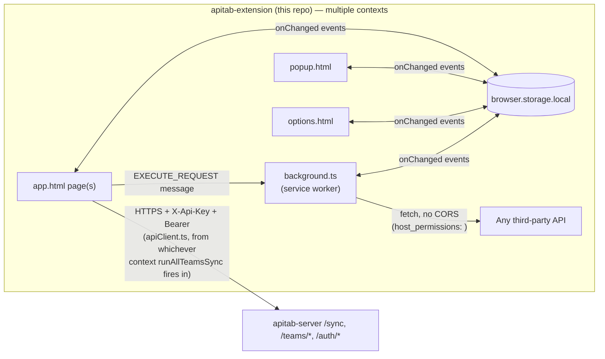
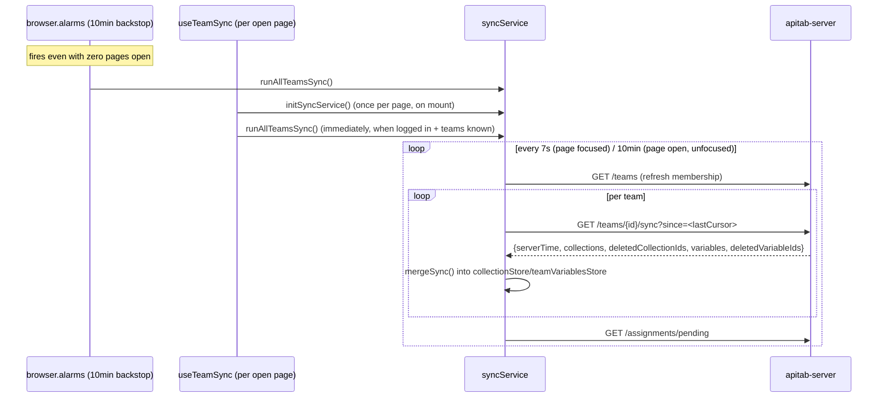
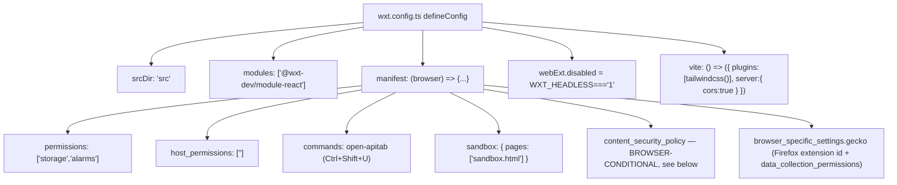

# ApiTab Browser Extension — SKILL.md

> This file is the permanent architectural knowledge base for **apitab-extension** (repo name `ApiTab`, package name `apitab`). It is written so that any AI coding assistant (or human) can understand the entire ApiTab ecosystem and this repository's role in it without exploring the code first, and can then confidently add features, fix bugs, and refactor without breaking cross-repo contracts.

---

## Part 0 — The ApiTab Ecosystem

### What ApiTab is

ApiTab is a lightweight, local-first API testing tool — "a fast, minimal alternative to Postman." A user builds and sends HTTP requests, organizes them into collections/folders, manages environments of `{{variables}}`, writes pre-request/post-response test scripts, and — optionally, if they create an account — shares collections with a team and keeps them in sync across devices.

### Why three repositories

| Repo | Role | Runtime |
|---|---|---|
| **apitab-server** | Backend/API. Owns accounts, teams, sharing permissions, and the sync protocol. Also serves the public marketing/download landing page. | Laravel 12 / PHP 8.2, self-hosted |
| **apitab-desktop** | Electron desktop client. Full request-builder UI, runs requests from the Electron **main process** (no CORS restrictions). | Electron 43 + React 19 + Zustand |
| **apitab-extension** (this repo) | Browser extension client — Chrome MV3 / Firefox MV2. Same request-builder UI, runs requests from the **background service worker**. | WXT + React 19 + Zustand |

This repo and `apitab-desktop` are **siblings that share almost the entire application layer** — the same Zustand store shapes, the same `@/*` import alias (this repo's is `@/*` → `src/*`, auto-supplied by WXT's generated `.wxt/tsconfig.json`; desktop's `@/*` → `src/renderer/src/*` was deliberately chosen to match), the same feature-folder structure, the same script-sandbox design (`new Function('apitab','pm','console', code)` run inside an isolated iframe), and a `syncService.ts` that is close to byte-identical between the two. **When porting a fix or feature between the two clients, the file layout and import paths are expected to match closely enough that a diff often applies almost unchanged.** This repo's own SKILL.md should be read alongside `apitab-desktop`'s whenever porting a change.

Where the two clients differ, it's because the platform forces it:

| Concern | This repo (extension) | apitab-desktop |
|---|---|---|
| Executing an HTTP request | `fetch` in the **background service worker** (`httpClient.ts`), reached via `browser.runtime.sendMessage` from any page | Node `fetch` in the Electron **main process**, reached via IPC |
| Local storage backing | `browser.storage.local` directly | `electron-store`, wrapped behind an async `browser.storage.local`-shaped IPC bridge |
| How many JS contexts exist at once | **Several, simultaneously** — background service worker + any number of open `app.html`/`popup.html`/`options.html` pages, **each with its own independent in-memory Zustand copy**, reconciled only through `browser.storage.local` + a `browser.storage.onChanged` listener (§5b below) | **One** — a single `BrowserWindow` renderer, no cross-context sync problem at all |
| Update mechanism | The browser's own extension-store auto-update (Chrome Web Store / Firefox AMO) — **no in-app update UI exists or is needed** | Self-managed via `electron-updater` against a GitHub Releases feed, with an in-app "update available" bell |
| Permission model | Manifest-declared permissions (`host_permissions: <all_urls>`, `storage`, `alarms`) enforced by the browser | Electron process isolation (`contextIsolation`, `nodeIntegration:false`, a typed `contextBridge` preload) |
| Keeping data fresh with no page open | A `browser.alarms` alarm (survives service-worker suspension, unlike a page-scoped timer) polls every 10 minutes even if no ApiTab page is open anywhere | Not applicable — the app process itself *is* the only "page," so if it's running, something is always polling |
| Platform/version lookup | Synchronous browser APIs (`import.meta.env.BROWSER`, `browser.runtime.getManifest()`), wrapped in `async` purely to keep a matching call signature with desktop's real IPC round-trip | Real async IPC round-trip |

### Responsibility split

- **apitab-server**: authentication, team membership/roles, per-user collection-assignment (sharing) state machine, the polling `/sync` endpoint, team-shared variables, usage analytics, the landing page.
- **apitab-desktop / apitab-extension (this repo)**: everything about actually building, sending, and inspecting HTTP requests; all UI; local-first storage (a signed-out user's data never touches the server at all); the sync *engine* that talks to the server's `/sync` endpoint on a timer.

### How this repo communicates with the server

Every request to `apitab-server` from this extension carries two headers, set in `src/config/server.ts`:

- `X-Api-Key: <API_KEY>` — a static, build-time key that must equal the server's `APP_API_KEY`. Checked before anything else, a coarse "legitimate client build" gate, not per-user authentication.
- `Authorization: Bearer <token>` — present once a user logs in, absent for anonymous/local-only usage.

`API_BASE_URL = 'https://apitab.bitflw.com/api'` — **the same production server URL and `API_KEY`** the desktop app points to; both clients share one backend deployment and one static key. Self-hosters must change both here (and in desktop's matching `config/server.ts`, and the server's `.env`) together.

### Data flow



Two entirely separate kinds of HTTP traffic happen from this extension: (1) the user's own API-under-test requests, always executed in the **background service worker** for CORS-free access via `host_permissions: <all_urls>`, and (2) this extension's own sync traffic to `apitab-server`, a plain `fetch` from `apiClient.ts` — this can run from *any* context (background, app page, options page), since `runAllTeamsSync()` is called from `background.ts` directly and from `useTeamSync.ts` in any open page.

### Authentication flow (as seen from this repo)

1. `LoginDialog.tsx` calls `apiClient.login`/`register` → server returns `{token, user}`.
2. `accountStore.setSession({token, user})` — persisted to `browser.storage.local` under key `apitab:account`.
3. Every subsequent `apiClient.ts` call attaches the bearer token automatically.
4. If `user.emailVerified === false`, `syncService.ts`'s `runAllTeamsSync()` refuses to poll and instead opens the login/verify dialog.
5. **A known, previously-real bug class, shared with desktop**: `LoginDialog.tsx`'s `afterAuthenticated()` calls `runAllTeamsSync({skipRehydrate: true})` immediately after setting the fresh session in memory. `skipRehydrate` is **required** — omitting it makes `runAllTeamsSync` re-read the account/team stores from `browser.storage.local` before trusting them (correct for a cold-started service-worker case), racing the just-written session's own unawaited persist write. If the disk read wins — plausible right after a **logout→login** cycle — the fresh session is silently clobbered back to `null` and sync aborts with no error, empty workspace. Diagnosed via a from-scratch zustand-persist reproduction, fixed, and **must never be removed from this call site**.

### Synchronization flow



A collection is visible only if the server considers the user's assignment `accepted` — see the server's SKILL.md Part 9/10 for the full protocol. This repo's job is to push local team-tagged edits, pull whatever changed, merge, and never invent client-side conflict resolution (409 → adopt the server's copy, no merge UI).

**A second known, previously-real bug class, shared with desktop**: `onCollectionsChanged` (the `collectionStore` subscriber in `syncService.ts`) treats any team-tagged collection disappearing from local state as "the user deleted it" and, for an owner/admin, pushes a real server `DELETE`. Logging out clears local team-collection state — if that clear isn't wrapped in the `applyingRemote` suppression flag first, the watcher fires for real and a plain logout silently soft-deletes every team collection the logged-out user owned/administered. Fixed by routing the logout-time clear through `syncService.ts`'s `clearTeamCollectionsOnLogout()`, which sets `applyingRemote = true` first. **Never call `useCollectionStore.getState().clearTeamCollections()` directly from a logout handler.**

### Shared concepts / terminology

See the server's SKILL.md Part 0 for the full glossary (Collection, Environment, Team/Workspace, Assignment, Shared variable, `since` cursor) — identical meanings here. This repo additionally uses:

| Term | Meaning in this repo |
|---|---|
| **Draft** | The single in-progress request being edited, held in `requestStore` (persisted key `apitab:draft`) — not the same as a *saved* request inside a collection. |
| **Personal workspace** | The UI's name for "no team selected" (`activeTeamId === null`) — collections with no `teamId`, purely local, never synced. |
| **Sandbox** | The isolated iframe (`sandbox.html`, a WXT/manifest sandbox entrypoint) where pre-request/post-response scripts actually execute — see Part 14. |
| **Entrypoint** | A WXT convention — a file/folder under `src/entrypoints/` that becomes a distinct extension surface (background worker, or an HTML page mapped into the manifest). See Part 4. |
| **Context** | One of the several independent JS execution environments this extension runs simultaneously — background worker, `app.html`, `popup.html`, `options.html`. See §5b / Part 9. |

### Shared design philosophy

Local-first, sync-optional; server is the sole authority on timestamps and conflicts; assignment-based (not blanket team-membership) sharing; soft-delete + id-reuse as a first-class flow. This repo's extra responsibility on top of that shared philosophy is **correctly reconciling multiple simultaneous JS contexts through a storage-events-only channel** — see §5b, the single biggest architectural fact unique to this repo.

### Version compatibility

No explicit versioning. `SyncResponse`/`Collection`/`TeamVariable`/etc. TypeScript interfaces in `src/types/` are hand-kept in sync with the server's `toWire()` shapes and with `apitab-desktop`'s matching types — there is no compile-time or runtime contract check across any of the three repos.

### Deployment relationship

**This repo has no CI/CD pipeline** — no `.github/workflows/` directory exists. Releases are produced entirely by local npm scripts (`build`, `build:firefox`, `zip`, `zip:firefox`) and uploaded manually to the Chrome Web Store / Firefox AMO (store review/publish is a manual, external process this repo's tooling doesn't touch). After every release, `apitab-server`'s landing page needs a manual update too (hardcoded version strings + the two extension `.zip` files copied into `public/downloads/` — see the server's SKILL.md Part 17).

---

## Part 1 — Project Overview

**Purpose**: a browser-native API testing client with feature parity to the desktop app, distinguished by living inside the browser (no separate install, works via `host_permissions` to bypass CORS on tested APIs) at the cost of running under a strict Manifest V3/V2 permission and CSP model.

**Goals**: byte-for-byte-as-possible parity with the desktop app's application layer; correct behavior despite running in multiple simultaneous, only-loosely-coupled JS contexts (the extension's hardest and most distinctive engineering problem).

**Target users**: developers who want API testing available directly in their browser, without installing a separate app — especially useful when testing APIs from the same browser session already logged into other services.

**Main features**: full request builder (params/headers/auth/body/scripts), collections + folders, environments with `{{variable}}` interpolation and autocomplete, pre-request/post-response test scripting (Postman-`pm`-API-compatible, sandboxed), response viewer (pretty/raw/table for JSON, preview/raw for HTML, headers, generated cURL/code snippets, test results), history, team collaboration (share/manage-access/accept/decline, team-shared variables), JSON backup/restore. **No self-update UI** (the browser handles that).

**Core philosophy**: local-first; fully useful with zero account, zero network beyond whatever API the user is testing.

**Architecture overview**: a WXT-built extension with five entrypoints (`background`, `app`, `popup`, `options`, `sandbox`), no router within any of them (each is its own standalone page), backed by ~13 Zustand stores persisted through `browser.storage.local`, reconciled across contexts via a `browser.storage.onChanged` listener plus a `browser.alarms`-driven backstop poll.

---

## Part 2 — Technology Stack

| Technology | Version | Why |
|---|---|---|
| WXT | ^0.20.27 | A Vite-based, framework-agnostic browser-extension build tool. Auto-generates `manifest.json` from file-system conventions (`src/entrypoints/`) plus a `defineConfig` for anything not derivable from file layout (permissions, CSP, commands). Chosen over hand-rolling a webpack+manifest setup or plain `@crxjs/vite-plugin`. |
| React | ^19.2.7 | UI library, matches the desktop app's version exactly (shared component code). |
| Zustand | ^5.0.14 | State management, matches desktop exactly. |
| Tailwind CSS | ^4.3.1 (via `@tailwindcss/vite`) | Styling, matches desktop exactly. |
| `@wxt-dev/module-react` | ^1.2.2 | WXT's official React integration module. |
| TypeScript | ^6.0.3 | Type safety. |
| axios | ^1.18.1 | **Not used for live request execution** — included only as the target of the Axios code-snippet generator (`utils/snippets.ts`). Actual requests always go through the background worker's own `fetch`. |
| uuid | ^14.0.1 | Client-side id generation, reused as-is server-side for team-shared entities. |
| lucide-react | ^1.21.0 | Icon set, matches desktop exactly. |

**Critical pinned combo**: Vite 7 + `@vitejs/plugin-react` 5. Bumping to Vite 8 / plugin-react 6 breaks WXT's dev-mode Fast Refresh preamble (`$RefreshReg$ is not defined`) — **do not upgrade these two packages independently of confirming WXT compatibility first.**

**What WXT gives you**: files under `src/entrypoints/` are auto-discovered. A folder containing `index.html` + a script becomes an HTML entrypoint, mapped into the manifest by **folder-name convention** — `popup/` → `action.default_popup`, `options/` → `options_ui.page`, any other name (`app/`, `sandbox/`) just becomes a standalone extension page reachable via `browser.runtime.getURL(...)`. A top-level `background.ts` exporting `defineBackground(() => {...})` becomes the MV3 service worker (or MV2 background script, per target). Everything else — `permissions`, `host_permissions`, `commands`, CSP, `browser_specific_settings`, the `sandbox` pages list — comes from the `manifest` field of `wxt.config.ts`'s `defineConfig`, which can be a function of `{browser}` for per-target overrides (used here specifically for the CSP field — see Part 4). Build output lands in `.output/<browser>-<manifest-version>/` (e.g. `chrome-mv3`, `firefox-mv2`).

---

## Part 3 — Folder Structure

```
src/
├── entrypoints/
│   ├── background.ts        # MV3 service worker / MV2 background script — see Part 4
│   ├── app/                 # index.html + main.tsx — the full workspace, built as app.html
│   ├── popup/                # index.html (w-[340px]) + main.tsx — toolbar popup
│   ├── options/               # index.html + main.tsx — settings page (open_in_tab)
│   └── sandbox/                # index.html + main.ts (no React) — script-execution sandbox
├── features/          # account/, collections/, environments/, history/, layout/, requests/ (+ tabs, response)
├── stores/             # 13 Zustand stores + persist.ts
├── services/            # apiClient, syncService, backup, httpClient, messaging, requestService, sandboxProtocol, scriptRunner, workspace
├── hooks/                # useActiveVariables, useAnalyticsSession, useApplyTheme, useClipboard, useKeyboardShortcuts, usePanelResize, useRequestActions, useTeamSync
├── components/            # AboutDialog, AppDialogs, CodeBlock, ConfirmDialog, KeyValueEditor, Logo, PendingAssignmentsBell, PromptDialog, ThemeToggle, Toaster, VariableAutocomplete, VariableInput, VariablePopover, + ui/
├── utils/                  # cn, collectionIO, collectionTree, curl, defaults, format, highlight, id, json, jsonPath, popoverPosition, postmanImport, query, runtimeInfo, scriptSandbox, snippets, ui, variables
├── types/                   # data model definitions, barrel index.ts
├── pages/                     # OptionsPage.tsx, PopupPage.tsx, WorkspacePage.tsx
├── config/                     # about.ts, server.ts
└── assets/                      # tailwind.css
```

Root also has: `wxt.config.ts`, `tsconfig.json` (extends the WXT-generated `./.wxt/tsconfig.json`, which supplies the `@/*` → `src/*` alias — regenerated by `wxt prepare`, run automatically via the `postinstall` script), `.output/` (build artifacts, gitignored except release zips may be kept locally), no `.github/workflows/`.

**Ownership rules**: `src/entrypoints/background.ts` is the only place a real network `fetch` for user-tested APIs happens — UI code must never call `fetch` directly for that purpose, always via `messaging.ts`'s `sendExecuteRequest`. `src/entrypoints/sandbox/` has zero access to `browser.*` APIs by design — never add any.

**What should never belong in `src/entrypoints/`**: anything that isn't meant to become a distinct manifest-visible surface — regular components go in `features/`/`components/`, not a new entrypoint folder.

---

## Part 4 — Architecture

### The manifest (`wxt.config.ts`, full picture)



- `permissions: ['storage', 'alarms']` — `storage` for persistence, `alarms` for the poll-sync backstop (§ below) that survives service-worker suspension.
- `host_permissions: ['<all_urls>']` — lets extension pages/the background worker issue cross-origin fetches (both user-tested APIs and the sync backend) without CORS.
- **`content_security_policy` is genuinely different per browser**, and this is not incidental:
  - **Chrome**: `sandbox: "sandbox allow-scripts allow-forms; script-src 'self' 'unsafe-inline' 'unsafe-eval'; object-src 'self';"` — Chrome MV3 forbids `unsafe-eval` in the normal `extension_pages` CSP entirely, so `eval`-class execution is confined to the dedicated, opaque-origin sandboxed page type.
  - **Firefox**: `{ extension_pages: "script-src 'self' 'unsafe-eval'; object-src 'self';" }` — Firefox has no true sandboxed-page origin isolation equivalent to Chrome's, so the manifest's `sandbox` key is effectively a no-op there; `unsafe-eval` has to be granted at the `extension_pages` level instead, meaning `sandbox.html` loads there as a normal (not opaque-origin) extension page on Firefox.
- `browser_specific_settings.gecko.data_collection_permissions`: `{required: ['none'], optional: ['personallyIdentifyingInfo', 'authenticationInfo']}` — an explicit, source-commented disclosure that the *core* extension collects nothing, and the optional team-sync feature only ever sends name/email/password to ApiTab's own backend, only on opt-in login.
- `webExt.disabled: process.env.WXT_HEADLESS === '1'` — lets `npm run dev` run headless (no auto-launched browser window) for CI/scripted contexts.
- `vite: { server: { cors: true } }` — **required in dev mode specifically because the sandbox page runs at an opaque (`null`) origin.** Without permissive dev-server CORS, the sandbox's live-reloaded module fetches are blocked by the browser (an opaque origin can't satisfy same-origin checks), causing every sandboxed script to time out with "Script sandbox was reset." Production builds are self-contained and unaffected — **this setting only matters for `npm run dev`, don't remove it thinking it's dead config.**

### Entrypoints (every one, what it does on load)

| Entrypoint | Manifest mapping | Behavior on load |
|---|---|---|
| `background.ts` | `background.service_worker` (MV3) / `background.scripts` (MV2) | (1) registers `browser.runtime.onMessage` for `EXECUTE_REQUEST`, delegating to `executeHttp`, returns `true` to keep the async channel open; (2) registers `browser.commands.onCommand` for `open-apitab` → `openWorkspace()`; (3) calls `initSyncService()`; (4) creates a repeating `browser.alarms` alarm `apitab:poll-sync` (`periodInMinutes: 10`) whose fire calls `runAllTeamsSync()` — this **survives service-worker suspension**, unlike `setInterval`, which is the entire reason it exists instead of a timer; (5) also fires `runAllTeamsSync()` on `browser.runtime.onStartup` and once unconditionally at module load. |
| `app/` (`app.html`) | standalone page (no manifest slot beyond being reachable via `browser.runtime.getURL`) | Mounts `<WorkspacePage/>` (→ `<Workspace/>`) into `#root`. The full workspace UI, opened as a real browser tab. |
| `popup/` (`popup.html`) | `action.default_popup` | Fixed 340px-wide toolbar popup, mounts `<PopupPage/>`. |
| `options/` (`options.html`) | `options_ui.page`, with `open_in_tab: true` (set via a `<meta name="manifest.open_in_tab" content="true">` tag in the entrypoint's own `index.html` — a WXT convention for manifest keys not otherwise derivable from file layout) | Mounts `<OptionsPage/>`. |
| `sandbox/` (`sandbox.html`) | `sandbox.pages` | No React. On load: posts `{type: SANDBOX_READY}` to `window.parent`; listens for `SANDBOX_RUN` messages, runs the payload via `runUserScript` (`utils/scriptSandbox.ts`), posts back `SANDBOX_RESULT`. Zero access to `browser.*` — communication is strictly `postMessage`. |

### Part 5b — Cross-Context Synchronization (the defining architectural problem of this repo)

**This does not exist in the desktop app and is the single biggest reason the two clients' `syncService.ts` files, while extremely similar, are not byte-identical.**

This extension runs **multiple independent JS contexts simultaneously**: the background service worker, and any number of open `app.html` tabs, `popup.html`, `options.html`. **Each context holds its own separate in-memory copy of every Zustand store.** `browser.storage.local` is the only thing actually shared between them — a write from one context is invisible to another's in-memory state until that other context re-hydrates.

`syncService.ts`'s own top-of-file comment states this directly:

> "collectionStore itself stays pure local state; this module watches it, pushes team-tagged edits, pulls periodic changes, and reconciles the two extension-context problems that come from `browser.storage.local` not being live-shared: (1) Each extension page (app/popup/options) and the background service worker hold independent in-memory copies of the Zustand store. A push made from the app page won't be visible in the background worker (or another open page) until that context re-hydrates from storage. (2) A pull merge must not immediately re-trigger a push of the very data it just wrote (feedback loop). The `applyingRemote` flag suppresses the push-on-mutation watcher for the duration of any remote-origin write (a pull merge, or a rehydrate caused by another context's push)."

```mermaid
sequenceDiagram
    participant PageA as app.html (tab 1)
    participant Storage as browser.storage.local
    participant PageB as app.html (tab 2) / background

    PageA->>PageA: user edits a team collection
    PageA->>PageA: onCollectionsChanged fires (applyingRemote=false)
    PageA->>Storage: pushTeamCollection() succeeds, local state updated
    PageA->>Storage: persist middleware writes apitab:collections
    Storage-->>PageB: browser.storage.onChanged({apitab:collections: {...}})
    PageB->>PageB: applyingRemote = true
    PageB->>PageB: useCollectionStore.persist.rehydrate()
    PageB->>PageB: applyingRemote = false; backfill pushedVersions for newly-seen ids
    Note over PageB: PageB's in-memory state now matches PageA's,<br/>without PageB re-pushing what it just absorbed
```

Mechanism, wired once per context inside `initSyncService()`:
- `useCollectionStore.subscribe(onCollectionsChanged)` / `useEnvironmentStore.subscribe(onEnvironmentsChanged)` — the push-on-mutation watchers, diffing against `pushedVersions`/`pushedVariableVersions` module-level `Map`s, no-op when `applyingRemote` is true.
- `browser.storage.onChanged.addListener((changes, area) => {...})` — the cross-context propagation listener. When `area === 'local'` and the changed keys include `'apitab:collections'` or `'apitab:teamVariables'` (i.e. **another** context just wrote), it sets `applyingRemote = true`, calls `useCollectionStore.persist.rehydrate()` / `useTeamVariablesStore.persist.rehydrate()` (Zustand's built-in re-read-and-apply API), then resets `applyingRemote = false` and backfills any newly-seen ids into the version maps so the just-absorbed data isn't immediately treated as a fresh local edit and re-pushed.
- `runAllTeamsSync()` explicitly awaits `useAccountStore.persist.rehydrate()`/`useTeamStore.persist.rehydrate()` before trusting `session`/`teams` — because on a freshly-woken service worker, persisted state may not have finished hydrating yet, and reading stale (empty) initial state would silently skip a poll. Accepts `opts.skipRehydrate` for callers (e.g. `LoginDialog.tsx` right after login) that just wrote `session`/`teams` themselves in the same tick — see Part 0.

**If you add a new cross-context-relevant store**, you must decide explicitly whether it needs this same `browser.storage.onChanged` reconciliation — most don't (e.g. `settingsStore`, `historyStore` are fine to just naturally rehydrate on next mount), but anything with a push-on-mutation watcher (currently only `collectionStore`/`environmentStore`) does.

---

## Part 5 — Core Modules

### `src/entrypoints/background.ts`

Covered fully in Part 4's table. This is the extension's most privileged context — the only place `httpClient.ts`'s `executeHttp` actually runs, the only place the `browser.alarms` backstop lives.

### `src/services/httpClient.ts`

`executeHttp(req: WireRequest): Promise<RequestResult>` — runs **inside the background service worker only**, called via the `EXECUTE_REQUEST` message listener in `background.ts`. Validates the URL is `http(s)://`, builds `Headers`/`FormData`/string body, does the actual `fetch` with an `AbortController` timeout, decodes via `TextDecoder`, classifies errors (`AbortError`→timeout, `TypeError`→network, else unknown). Combined with `host_permissions: <all_urls>`, running here bypasses page CORS restrictions and can read every response header — this is the exact extension analogue of desktop's `main/requestHandler.ts`.

### `src/services/messaging.ts`

`EXECUTE_REQUEST` message type, `WireRequest` interface, `sendExecuteRequest(payload)` → `browser.runtime.sendMessage(...)`, awaits the `RequestResult`. The extension's direct equivalent of desktop's `window.api.request.send`.

### `src/services/workspace.ts`

`WORKSPACE_PATH = '/app.html'`, `getWorkspaceUrl()`, `openWorkspace()` — queries existing tabs for one already at the workspace URL and focuses it (`browser.tabs.update` + `browser.windows.update`) instead of opening a duplicate; falls back to `browser.tabs.create`. Called from the `open-apitab` keyboard command and from `PopupPage.tsx`'s "Open ApiTab" button.

### `src/services/apiClient.ts`, `syncService.ts`, `backup.ts`, `requestService.ts`, `scriptRunner.ts`, `sandboxProtocol.ts`

Same responsibilities as their desktop counterparts — see Part 0/9/14. `syncService.ts` additionally owns the `browser.storage.onChanged` listener described in §5b, which desktop's version doesn't have.

---

## Part 6 — Data Models

Full type definitions live in `src/types/`, barrel-exported via `index.ts`. These **must stay structurally identical to `apitab-desktop`'s own `src/renderer/src/types/`** — they're meant to be portable, unmodified, between the two repos. See `apitab-desktop`'s SKILL.md Part 6 for the full field-by-field table (identical here): `ApiRequest`, `KeyValue`, `AuthConfig`, `RequestBody`, `Collection`, `CollectionFolder`, `Environment`, `EnvVariable`, `Team`, `TeamMember`, `TeamVariable`, `PendingAssignment`, `CollectionAssigneeStatus`, `HistoryEntry`, `Settings`, `BackupData`, `SyncResponse`, `ScriptRun`, `ScriptContext`, `AuthSession`, `AuthUser`.

`ApiErrorType` in this repo's `types/response.ts` is `'network'|'cors'|'timeout'|'abort'|'invalid-url'|'unknown'` — matches desktop's renderer-side type exactly (both have the extra `'cors'`/`'abort'` variants beyond what the background/main-process layer itself can produce).

---

## Part 7 — APIs (This Extension's Two Communication Layers)

### 7a. Messaging (page ⇄ background) — the local API

| Message type | Sender | Handler | Purpose |
|---|---|---|---|
| `EXECUTE_REQUEST` | any page, via `messaging.ts`'s `sendExecuteRequest` | `background.ts`'s `onMessage` listener → `httpClient.ts`'s `executeHttp` | Run a user's API-under-test request with no CORS restriction. |

That's the entire custom messaging surface — everything else routes through `browser.storage.local` + `browser.storage.onChanged` (§5b), not direct messaging.

### 7b. HTTP calls to apitab-server — the remote API

Identical method-to-route mapping as `apitab-desktop`'s `apiClient.ts` — see that repo's SKILL.md Part 7b for the full table (this repo's `apiClient.ts` has the same method names calling the same routes). Every call sends `X-Api-Key`; calls with `auth=true` (default) also send `Authorization: Bearer` if a session exists. Full route/auth-tier detail is in the server's SKILL.md Part 7.

---

## Part 8 — UI Architecture

**No router, three separate entrypoint pages instead** (Part 4): `app.html` (the full workspace), `popup.html` (short-lived toolbar overlay), `options.html` (settings). They're separate WXT entrypoints — not routes within one SPA — because each maps to a distinct manifest surface with a distinct lifecycle: the popup closes on any navigation, options is Chrome/Firefox's own dedicated settings-page convention, and only the app needs full workspace screen space and persistent tab lifetime.

**Feature folders** (`src/features/`) — identical structure and purpose to `apitab-desktop`'s (see that repo's SKILL.md Part 8 table): `account/` (`AccountMenu.tsx` exporting `TeamSelector`/`SyncButton`/`AccountAvatar`, `LoginDialog.tsx`, `ManageTeamDialog.tsx`, `ChangePasswordDialog.tsx`), `collections/` (`CollectionsPanel.tsx`, `ShareToTeamDialog.tsx`), `environments/`, `history/`, `layout/` (`Workspace.tsx`, `TopBar.tsx`, `Sidebar.tsx`), `requests/` (`RequestEditor.tsx` + `tabs/*` + `response/*`).

**`Workspace.tsx`** wires `useApplyTheme`/`useTeamSync`/`useAnalyticsSession`/`useKeyboardShortcuts`, composes `TopBar` + `Sidebar`/`SidebarRail` + the request-builder column + `Toaster` + `AppDialogs`.

**`TopBar.tsx`**'s utilities cluster has `SyncButton` + `PendingAssignmentsBell` + theme toggle + About + a settings button that calls `browser.runtime.openOptionsPage()` (unlike desktop, which toggles an in-window overlay — this repo's Settings is genuinely a separate page). **No `UpdateAvailableBell` equivalent exists here** — confirmed absent by design (Part 0): browser-store auto-update replaces the entire concept.

**Reusable `ui/` primitives** (`src/components/ui/`): same set as desktop — `Button`, `IconButton`, `Input`, `Textarea`, `Select` (custom-styled, portal-rendered, since native `<select>` popups can't be themed), `Tabs`, `Modal`, `Badge`, `Spinner`, `CopyButton`, `Toggle`, `EmptyState`, plus a `Menu.tsx` (dropdown action menu, not in the barrel export — imported directly).

**Note**: `TopBar.tsx` defines its own local `ThemeToggle` function rather than importing the standalone `components/ThemeToggle.tsx` — a minor, harmless duplication, not a bug, but don't assume editing `components/ThemeToggle.tsx` affects the top bar.

---

## Part 9 — State Management

All state lives in Zustand stores under `src/stores/`. `persist.ts` exports `browserLocalStorage: StateStorage`, implemented directly via `browser.storage.local.get/set/remove` (no IPC hop needed here, unlike desktop — this is the extension's native storage API). Every persisted store uses `createJSONStorage(() => browserLocalStorage)`.

| Store | Persisted? | Storage key | Notes |
|---|---|---|---|
| `accountStore` | Yes | `apitab:account` | `session: AuthSession \| null`. |
| `teamStore` | Yes | `apitab:teams` | Same `setTeams`-preserves-`activeTeamId`-or-falls-back-to-`null` (never `teams[0]`) behavior as desktop — see that repo's SKILL.md Part 9 for the "hijacked workspace selection" history. |
| `collectionStore` | Yes | `apitab:collections` | Same tree CRUD + `mergeSync`/`clearTeamCollections` as desktop — **but this is the store at the center of §5b's cross-context reconciliation, which desktop's identical-looking store doesn't need.** |
| `environmentStore` | Yes | `apitab:environments` | Same shared-pool-as-base-layer `getActiveVariables()` as desktop. |
| `teamVariablesStore` | Yes | `apitab:teamVariables` | Same as desktop. |
| `pendingAssignmentsStore` | **No** | — | Ephemeral, refetched every sync tick. |
| `settingsStore` | Yes | `apitab:settings` | Same fields as desktop. |
| `historyStore` | Yes | `apitab:history` | Same. |
| `dialogStore` | **No** | — | **No `settingsOpen` field** (unlike desktop) — this repo's Settings is a real separate page (`options.html`), opened via `browser.runtime.openOptionsPage()`, not an in-app overlay. |
| `toastStore` | **No** | — | Same. |
| `uiStore` | Yes | `apitab:ui` | Same. |
| `requestStore` | Yes | `apitab:draft` | Same `send()` orchestration and `responseCache` keying as desktop. |
| `tableConfigStore` | **No** (deliberately) | — | Same as desktop. |

**Every persisted store here is a candidate for the §5b cross-context staleness problem** — any component reading directly from a store's in-memory state should be aware the value might be a tick behind what another open tab just wrote, until the next `browser.storage.onChanged` reconciliation or the next sync poll. In practice this is rarely user-visible (the reconciliation is near-instant), but it's the reason `runAllTeamsSync`'s rehydrate-before-trusting pattern (Part 0) exists at all.

---

## Part 10 — Storage

**Backing store**: `browser.storage.local` directly — no IPC hop (this repo has no separate privileged process the way Electron does; the background service worker is just another context with the same `browser.storage` access as any page). Accessed via `persist.ts`'s `browserLocalStorage` adapter, same interface shape as desktop's `electron-store`-backed one, but implemented natively here.

**No IndexedDB used** for app state (despite being available in extension pages) — `browser.storage.local` was chosen uniformly, likely for its built-in cross-context `onChanged` event, which IndexedDB doesn't natively provide and which §5b's entire reconciliation mechanism depends on.

**Migration strategy**: identical philosophy to desktop — each store with a nontrivial persisted shape has a custom Zustand `merge` function backfilling/sanitizing old data on rehydrate (`collectionStore`'s `normalizeContainer`, `environmentStore`'s corrupted-field sanitization, `requestStore`'s `normalizeForEditing`). Add to these, don't assume a clean slate.

**"Clear all data"** (`OptionsPage.tsx`) calls `browser.storage.local.clear()` then `location.reload()`.

---

## Part 11 — Configuration

| Setting | Location | Purpose |
|---|---|---|
| `API_BASE_URL`, `API_KEY` | `src/config/server.ts` | Same production `apitab-server` URL/key as desktop — hardcoded, self-hosters change both. |
| `ABOUT` | `src/config/about.ts` | Developer/links/tech-stack metadata. `SIBLING_REPO_URL` explicitly cross-references `apitab-desktop`. |
| `wxt.config.ts` | repo root | Build/manifest configuration — see Part 4. |
| No `.env` file | — | Same as desktop — everything client-side is a hardcoded TS constant, no build-time env-var injection. |

No feature flags exist anywhere in this codebase.

---

## Part 12 — Security

- **Manifest-declared permission model**: `permissions: ['storage', 'alarms']`, `host_permissions: ['<all_urls>']` — this extension's entire capability surface is statically declared and enforced by the browser, unlike Electron's process-isolation model. `<all_urls>` is broad and is exactly what enables the CORS-free request execution (Part 0/5) — it is also the single most privacy-sensitive permission this extension requests, and the `browser_specific_settings.gecko.data_collection_permissions` disclosure (Part 4) exists specifically to be upfront about what is and isn't actually collected despite that broad access.
- **The script sandbox** (Part 14) is the extension's analogue to desktop's script-sandbox security model, but the *hosting mechanism differs by necessity*: Manifest V3 (Chrome) forbids `unsafe-eval` in normal extension pages entirely, so the dedicated `sandbox` manifest-page type — an opaque/`null`-origin context reachable only via `postMessage`, with zero `browser.*` access — is the *only* way to run `new Function(...)`-class code at all. On Firefox, where sandboxed-page origin isolation doesn't exist the same way, the CSP relaxation is granted at `extension_pages` level instead (Part 4) — meaning `sandbox.html` is *not* opaque-origin on Firefox, though it still has no preload-equivalent privileged bridge and no `browser.*` access by omission (nothing in the sandbox entrypoint's own code ever imports or calls a `browser.*` API).
- **`X-Api-Key`/Bearer token handling**: same as desktop, stored in plain `browser.storage.local` — no additional encryption layer, a deliberate scope decision at this project's size.
- **CSP is genuinely browser-conditional** (Part 4) — this is a real, necessary divergence driven by Chrome MV3 vs. Firefox MV2 CSP capabilities, not an inconsistency to "fix" by unifying.

---

## Part 13 — Coding Standards

Same conventions as `apitab-desktop` (see that repo's SKILL.md Part 13) — `@/*` alias always resolves to `src/*` here (WXT auto-generates this via `.wxt/tsconfig.json`), Zustand stores are the single source of truth, `syncService.ts` owns all "should this push to the server" logic, comments explaining *why* (not *what*) are expected especially around the two timing-sensitive mechanisms (`skipRehydrate`, `applyingRemote`) **and** the cross-context reconciliation logic unique to this repo (§5b) — that third category doesn't exist in desktop's codebase and needs its own comment density here.

One extension-specific rule: **never call `fetch` for a user-tested API from anywhere except `httpClient.ts`, running inside `background.ts`'s message handler.** A `fetch` call from `app.html`/`popup.html`/`options.html` directly would be subject to that page's own CORS restrictions — the entire point of routing through the background worker is bypassing that via `host_permissions`.

---

## Part 14 — Development Workflow

```bash
npm install              # runs `wxt prepare` via postinstall, generating .wxt/tsconfig.json (@/* alias)
npm run dev               # wxt — launches Chrome with the extension auto-loaded, hot reload
npm run dev:firefox        # wxt -b firefox
npm run compile             # tsc --noEmit — run before every commit
npm run build                # wxt build → .output/chrome-mv3 (production, self-contained)
npm run build:firefox         # wxt build -b firefox → .output/firefox-mv2
npm run zip / zip:firefox      # wxt zip — store-ready .zip bundles
```

**Critical distinction**: `.output/chrome-mv3` (production) vs. `.output/chrome-mv3-dev` (depends on the live `localhost` dev server still running) — **only load `chrome-mv3` (not `-dev`) for anything resembling a real test**, per the repo's own README warning.

**Debugging**: load `.output/chrome-mv3` (or `firefox-mv2`) as an unpacked/temporary extension. The background service worker has its own DevTools (accessible via `chrome://extensions` → "service worker" link); each page (`app.html`/`popup.html`/`options.html`) is debuggable normally via right-click → Inspect, or via its own separate DevTools window.

**Testing**: no automated test suite exists in this repo either (matches desktop — no Jest/Vitest/Playwright config found). The established verification pattern for a release-blocking change: build `chrome-mv3`, launch it via Playwright's persistent-context Chromium API (`launchPersistentContext` with `--load-extension`/`--disable-extensions-except` pointed at the built output) for a scripted screenshot+DOM-assertion pass. This is how real, previously-shipped bugs in this repo were caught and proven fixed (the login-race and logout-delete bugs in Part 0 were both diagnosed and verified this way).

**Release process**: `npm run build && npm run build:firefox && npm run zip && npm run zip:firefox`, bump `version` in `package.json` first. Manual upload to the Chrome Web Store / Firefox AMO (external review process, not automatable from this repo). Then: manual follow-up to `apitab-server`'s landing page (Part 0) — copy the new `.zip` files into `public/downloads/`, update the version-text strings.

---

## Part 15 — Design Decisions

- **WXT over hand-rolled manifest/build tooling.** Gets file-convention-based entrypoint discovery and cross-browser manifest generation for free, at the cost of a real, previously-encountered fragility: the Vite-7/plugin-react-5 pin (Part 2) — WXT's dev-mode Fast Refresh integration is sensitive to that exact combination. Accepted tradeoff given how much manual manifest-wrangling WXT otherwise eliminates.
- **`browser.storage.local` over IndexedDB**, uniformly for all persisted stores, specifically because its `onChanged` event is the load-bearing mechanism behind §5b's entire cross-context reconciliation design. Tradeoff: `browser.storage.local` has a smaller size quota than IndexedDB — acceptable at this app's typical data volume (API request collections, not large binary blobs).
- **A dedicated `sandbox` manifest entrypoint for script execution, with browser-conditional CSP**, rather than trying to unify Chrome/Firefox behavior. This is forced by real, differing platform constraints (Chrome MV3's `extension_pages` CSP flatly forbids `unsafe-eval`; Firefox has no equivalent sandboxed-page origin isolation) — not a design choice with a simpler alternative.
- **A `browser.alarms` backstop poll in addition to per-page focus-aware polling**, specifically because `setInterval`/`setTimeout` in a service worker do not survive suspension, and there may be long stretches where zero ApiTab pages are open at all. `alarms` was chosen over, e.g., relying solely on `runtime.onStartup`, because it keeps data reasonably fresh even during long idle periods where the browser itself stays open but no ApiTab surface does.
- **No CI/CD for this repo** (Part 0/14) — store-review processes (Chrome Web Store, Firefox AMO) are external, manual, and slow enough that full automation wasn't judged worth building yet; local npm scripts + manual upload is the accepted current process.

---

## Part 16 — Common Patterns

Shares every pattern documented in `apitab-desktop`'s SKILL.md Part 16 (`applyingRemote` suppression, `skipRehydrate` opt-out, version-map dirty-tracking, rehydrate-time repair `merge` functions, server-wins conflict resolution) — re-read that section, it applies here verbatim. This repo adds one more:

- **Cross-context reconciliation via `browser.storage.onChanged`** (§5b): any store whose local mutations should be visible to *other simultaneously-open contexts* (not just persisted-and-picked-up-on-next-mount) needs its changed-keys checked in `syncService.ts`'s `onChanged` listener, with a `persist.rehydrate()` call wrapped in `applyingRemote`. Currently only `collectionStore`/`teamVariablesStore` do this. If you add a new store that needs the same live cross-tab consistency (e.g. a hypothetical live-collaboration cursor feature), follow this exact pattern rather than inventing a new one.

---

## Part 17 — Extension Guide (How To Safely Add Things Here)

### Add a new entrypoint (new manifest-visible surface)

1. Create `src/entrypoints/<name>/` with an `index.html` + entry script (React: `main.tsx`; non-React like the sandbox: plain `.ts`).
2. If the folder name maps to a known manifest slot (`popup`, `options`), WXT wires it automatically. For anything else, it becomes a standalone page reachable via `browser.runtime.getURL('/<name>.html')`.
3. If it needs manifest keys WXT can't derive from file layout (a new permission, a CSP override, etc.), add them to `wxt.config.ts`'s `manifest` function.
4. Run `npm run compile` and `npm run dev` to verify the manifest generates as expected — check `.output/chrome-mv3/manifest.json` directly if unsure.

### Add a new message type (page ⇄ background)

Only do this for something that genuinely needs the background worker's elevated `host_permissions` access (or its persistence across all pages being closed) — most cross-context data flow should go through `browser.storage.local` + the existing sync/reconciliation machinery (§5b), not a new bespoke message type. If you do need one: define the message shape (mirror `messaging.ts`'s `WireRequest` pattern), add a `browser.runtime.onMessage` case in `background.ts`, return `true` from the listener to keep the async channel open if the handler is async.

### Port a fix from the desktop app (or vice versa)

Given the shared `@/*`-aliased architecture, most fixes in `stores/`, `services/` (except `httpClient.ts`/`messaging.ts`, which are inherently platform-specific), `utils/`, and platform-neutral `components/`/`features/` port with identical or near-identical diffs. Before porting:
1. Confirm the file exists at the same relative path in both repos.
2. Diff the two versions first — check this repo's Part 0 table and desktop's SKILL.md for known, intentional divergences (e.g. `runtimeInfo.ts`'s sync-vs-async reality, the extra `browser.alarms` backstop, `dialogStore`'s missing `settingsOpen` field here) before assuming a diff should be identical.
3. After porting, run `npm run compile` here and `npm run typecheck` in desktop — a fix that compiles in one may not in the other if it touches a platform-specific type or API.
4. If the fix touches `syncService.ts`, double-check whether it interacts with §5b's cross-context reconciliation — this repo's version of that file has logic desktop's doesn't need at all, and a naive full-file port could silently remove it.

### Add a new syncable data type

Same server-coordinated checklist as desktop's SKILL.md Part 17 — a `mergeSync(teamId, incoming, deletedIds)` store action, a matching `apiClient.ts` method, a call site in `syncService.ts`'s `runSyncTick`, and — specific to this repo — a decision on whether it needs `browser.storage.onChanged` cross-context reconciliation (§5b/Part 16).

---

## Part 18 — Things That Must Never Change

Everything in `apitab-desktop`'s SKILL.md Part 18 applies here too (`skipRehydrate`, `clearTeamCollectionsOnLogout`, server-trusted timestamps). This repo additionally must never:

- **Remove the `browser.alarms` backstop poll from `background.ts`.** Without it, a user who never leaves an ApiTab tab open for more than a few minutes at a time would see sync silently stall for arbitrarily long periods between opens.
- **Call `fetch` for a user-tested API from any context other than `background.ts`'s message handler.** Breaks CORS-free execution, the extension's core value proposition versus a plain webpage-based tool.
- **Let `sandbox.html` gain a `browser.*`-API-capable bridge of any kind.** Its entire security model depends on being reachable only via `postMessage`, with no privileged surface at all — unlike desktop's sandbox iframe (which is *structurally* incapable of reaching `window.api` since it has no preload script), this repo's sandbox's isolation comes from the manifest's `sandbox` page type + never importing `browser.*` in the sandbox entrypoint's own code — **be deliberate about never adding such an import.**
- **Keep the CSP browser-conditional** (Chrome vs. Firefox) in `wxt.config.ts` — unifying it would break one platform or the other (Part 4/15).

---

## Part 19 — Known Limitations

- No automated test suite (Part 14) — same gap as desktop.
- No CI/CD pipeline at all (Part 0/14) — releases are entirely manual, including store submission.
- `TopBar.tsx` defines its own local `ThemeToggle` rather than reusing `components/ThemeToggle.tsx` — harmless duplication (Part 8).
- Landing-page release-note sync is entirely manual (Part 0) — same recurring risk as desktop.
- README's architecture diagram and "Future-proof by design" section are stale — they predate `sandbox/`, `history/`, `tableConfigStore`, `postmanImport.ts`, and the entire team-sync/account/analytics feature set, and the roadmap section lists "team workspaces" as a future idea despite it being fully implemented. Don't trust the README's architecture section over this file or the actual source.
- The Chrome-built manifest's `action.default_title` strips the em-dash suffix present in `wxt.config.ts`'s source string (`"ApiTab — Open API tester"` → built manifest shows `"ApiTab"`) — a minor, unexplained WXT/webext-polyfill normalization, not investigated further, cosmetic only.

---

## Part 20 — Future Roadmap (Inferred, Not Committed)

- Some form of CI (Part 19) — at minimum a `tsc --noEmit` check on push, given none currently exists.
- Automating the landing-page release-note sync (same suggestion as the server/desktop SKILL.md files).
- A formal test suite, likely Playwright-based given the extension-loading verification pattern already used ad hoc for release testing (Part 14) — could be formalized into a real CI-runnable suite.
- Revoking an already-accepted collection assignee — a server-side gap (see server SKILL.md Part 20) that would need matching UI here once the endpoint exists, mirroring the same note in desktop's roadmap.

---

## Part 21 — AI Contributor Guide

**Read first, in this order**: this SKILL.md in full → `wxt.config.ts` (the manifest source of truth) → `src/entrypoints/background.ts` (the most privileged context) → `src/services/syncService.ts` (read its own top-of-file comment carefully — §5b is not optional context) → whichever `features/`/`stores/`/`services/` file you're about to touch → the equivalent file in `apitab-desktop`, if your change should be ported both ways.

**Files to rarely modify without very good reason**: `wxt.config.ts`'s `manifest.content_security_policy` (browser-conditional for real platform reasons, Part 4/18), `src/entrypoints/sandbox/main.ts` (never add a `browser.*` import here, Part 18), `src/services/httpClient.ts`'s registration point in `background.ts` (the only legitimate place for user-tested-API `fetch` calls).

**Architecture rules that must never be violated**: see Part 18 in full, plus everything inherited from `apitab-desktop`'s Part 18.

**Implementation workflow for a typical change**:
1. Identify whether the change is single-context (a component, a pure util) or touches shared/cross-context state (a store, `syncService.ts`) — the latter needs §5b considered explicitly.
2. If it touches sync-visible data, check the server's SKILL.md for whether a server-side change is also needed.
3. If it's a UI/store/service change with a desktop-repo equivalent, consider porting both ways in the same logical change (Part 17).
4. Make the change, respecting Part 16's patterns (including the cross-context one, if relevant).
5. `npm run compile` — must pass.
6. Build (`npm run build`) and load `.output/chrome-mv3` as an unpacked extension; actually exercise the change across **multiple simultaneously open contexts** (e.g. two `app.html` tabs, or the popup + an app tab) if it touches `collectionStore`/`environmentStore`/`syncService.ts` — a single-tab test will not catch a §5b regression.

**Review checklist before considering a change done**:
- [ ] `npm run compile` passes
- [ ] No `fetch` for user-tested APIs added outside `background.ts`'s message handler (Part 13/18)
- [ ] Any new persisted store has a `merge` function tolerant of old persisted shapes
- [ ] Any new remote-origin store write is wrapped in `applyingRemote = true/false`
- [ ] If the store is cross-context-relevant (§5b), the `browser.storage.onChanged` listener was checked/updated
- [ ] Any change near `LoginDialog.tsx`'s auth flow double-checked against `skipRehydrate`
- [ ] Tested with **more than one context open simultaneously** if the change touches sync-relevant state
- [ ] If the change has an obvious desktop-repo counterpart, it was at least considered for porting

**Common mistakes to avoid** (real, previously-shipped bugs, shared with desktop plus one extension-specific class):
- Omitting `skipRehydrate: true` on a post-login sync call.
- Clearing `collectionStore`'s team collections without `clearTeamCollectionsOnLogout()`.
- Testing a store/sync change in only one open tab/page and missing a §5b cross-context reconciliation gap that only shows up with two contexts open at once.
- Adding a `fetch` call for a user-tested API from a page context instead of routing through `background.ts` — works fine in testing against permissive APIs, silently breaks against any API with a real CORS policy.

**How to safely refactor**: everything in desktop's SKILL.md Part 21 applies, plus: never simplify `syncService.ts`'s `browser.storage.onChanged` listener or the `applyingRemote`/`pushedVersions` bookkeeping around it without first re-reading §5b in full and testing with multiple contexts open — this is the one mechanism in this repo with no equivalent anywhere else in the codebase to cross-check against, and its failure mode (stale/duplicated pushes across tabs) is easy to not notice in a quick single-tab test.

---

## Part 22 — Repository Glossary

Everything in `apitab-desktop`'s SKILL.md Part 22 applies here with identical meanings (Request, Collection, Workspace, Environment, Draft, Session, Sandbox), plus:

| Term | Definition |
|---|---|
| **Entrypoint** | A WXT file-system convention — `src/entrypoints/<name>/` becomes a distinct extension surface (Part 4). |
| **Context** | One of the several independent, simultaneously-running JS environments this extension has: background service worker, and any open `app.html`/`popup.html`/`options.html` page — each with its own in-memory store copy (§5b). |
| **Background script / service worker** | `src/entrypoints/background.ts` — the most privileged context, the only place user-tested-API `fetch` calls happen, home of the `browser.alarms` sync backstop. |
| **`browser.alarms` backstop** | The 10-minute repeating alarm that keeps sync running even when no ApiTab page is open anywhere (Part 4/18) — has no desktop equivalent. |
| **`browser.storage.onChanged`** | The event that makes §5b's cross-context reconciliation possible — fires in every context when any other context writes to `browser.storage.local`. |
| **Manifest** | The browser-extension manifest (`manifest.json`), auto-generated by WXT from file conventions + `wxt.config.ts`'s `defineConfig` — genuinely different between the Chrome (MV3) and Firefox (MV2) build outputs, most notably in CSP (Part 4). |
